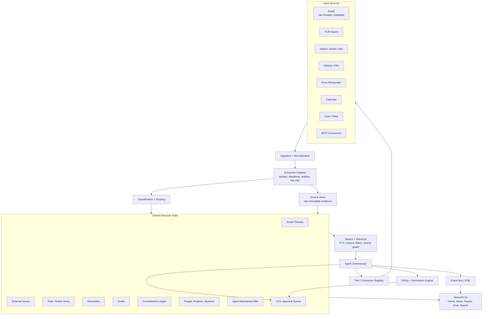
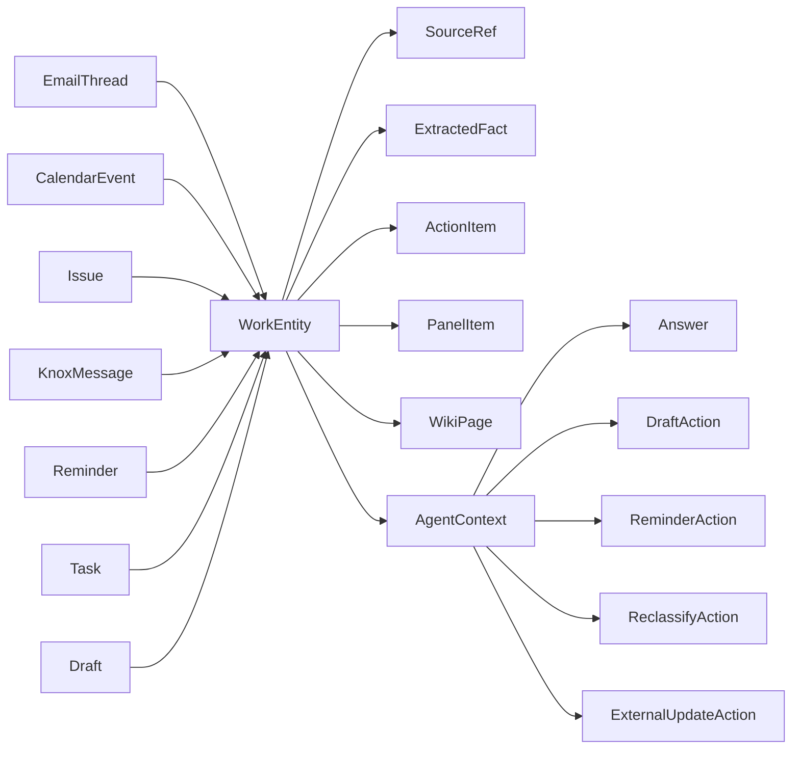
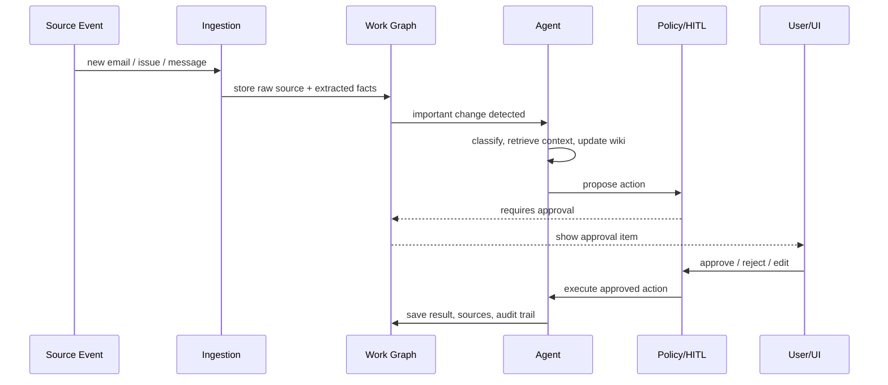
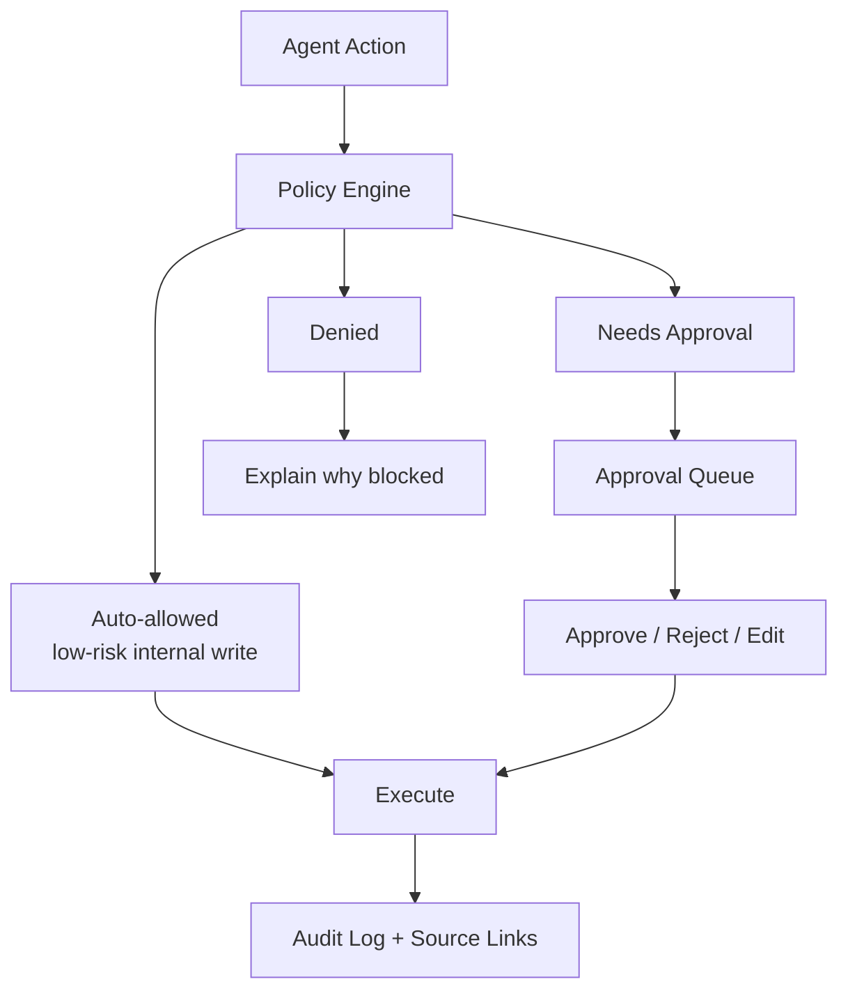
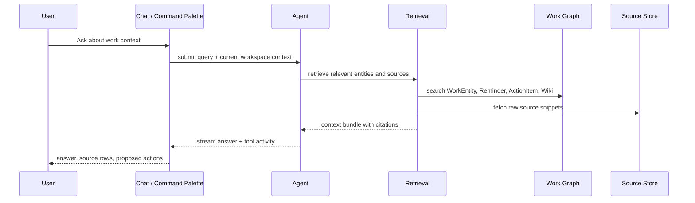
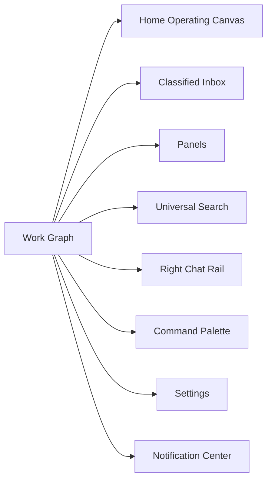

# NexusAI Agentic Work OS Architecture

> Earlier concept note. The current design is in [`ARCHITECTURE.md`](../ARCHITECTURE.md).

This note captures the architecture direction discussed from studying Hermes Agent and adapting the useful patterns to NexusAI. It is intentionally conceptual: borrow the architecture ideas, not Hermes implementation details.

## Core Framing

NexusAI should not be designed as a chatbot with side panels. It should be an agentic work graph where chat, inbox, panels, reminders, wiki, and command palette are all surfaces over the same owned state.

Hermes is useful inspiration because it has:

- One agent runtime behind many surfaces.
- A tool registry and toolset boundary.
- Plugin and connector style extension points.
- Streaming activity from model and tool work.
- Human-in-the-loop approval patterns.
- Local state, session history, search, memory, and scheduled/proactive work.

But NexusAI has a different product center:

```text
Hermes:  user message -> agent loop -> tools -> session memory
NexusAI: source events -> work graph -> agent reasoning -> approved actions
```

## High-Level Architecture



## Four-Layer Mental Model

```text
1. Evidence Layer
   Raw emails, issues, Knox messages, calendar events, docs, source metadata.

2. Understanding Layer
   Extracted facts, entities, deadlines, summaries, classifications, confidence.

3. Work OS Layer
   Nexus-owned reminders, todos, commitments, wiki, panels, drafts, approvals.

4. Agent Layer
   Answers questions, updates wiki, proposes actions, executes approved work.
```

The most important abstraction is not `ChatMessage`. It is:

```text
SourceRecord -> ExtractedFact -> WorkEntity -> AgentAction -> ApprovalState
```

## Core Domain Model



Suggested core records:

- `SourceRecord`: immutable raw evidence from email, PLM, Swarm, Knox, Calendar, GitHub, docs.
- `SourceReference`: citation pointer into a source record, including snippet and timestamp.
- `ExtractedFact`: deadline, owner, ask, promise, blocker, risk, decision, key info.
- `WorkEntity`: normalized object that NexusAI understands and can route.
- `ActionItem`: Nexus-owned todo/action, not a copied external task.
- `Reminder`: Nexus-owned reminder linked to source/entity.
- `Commitment`: promise or expected follow-up extracted from work context.
- `WikiPage`: agent-maintained durable knowledge page with citations.
- `AgentAction`: proposed or executed action.
- `ApprovalState`: pending, approved, rejected, edited, auto-approved.

## Proactive Agent Loop



## Agent Tool Categories

Read tools:

- `search_sources`
- `get_email_thread`
- `get_issue_context`
- `get_knox_thread`
- `get_calendar_context`
- `search_wiki`
- `get_commitment_ledger`
- `find_related_entities`

Write tools:

- `create_reminder`
- `create_action_item`
- `update_wiki_page`
- `draft_email`
- `draft_knox_message`
- `create_panel`
- `reclassify_email`
- `record_feedback`

External action tools:

- `send_email`
- `post_knox_message`
- `update_plm_issue`
- `comment_on_github`
- `schedule_calendar_event`
- `update_swarm_status`

Control tools:

- `request_approval`
- `explain_sources`
- `record_feedback`
- `suppress_pattern`
- `escalate_to_user`

Important rule:

Writes and external actions should usually create proposed actions first. The policy engine decides whether they need explicit user approval.

## HITL Policy Boundary



Examples:

- Auto-allowed: classify email, create draft, update internal wiki note, create low-risk reminder.
- Needs approval: send email, post Knox message, update PLM issue, modify calendar, create broad classifier rule.
- Denied: destructive external action, cross-boundary data leak, action without source grounding.

## NexusAI Backend Modules

```text
apps/web
  Next.js UI: inbox, home, panels, chat rail, command palette.

packages/ui
  NexusAI design primitives and semantic tokens.

packages/domain
  Shared types: SourceRecord, WorkEntity, ActionItem, Reminder, WikiPage.

packages/client-api
  Typed API client and SSE/event client.

server/ingestion
  Source adapters for email, PLM, Swarm, Knox, GitHub, Calendar, docs.

server/extraction
  Key info, deadlines, owners, commitments, entities, summaries.

server/classification
  Routing rules, priority inbox, feedback and reclassification loop.

server/work-graph
  Canonical Nexus-owned objects: actions, reminders, drafts, wiki, entities.

server/wiki
  LLM-maintained project/user/system wiki with citations back to sources.

server/agent
  Planner, tool runner, source-grounded answerer, proactive worker.

server/tools
  Registry of safe capabilities exposed to the agent.

server/policy
  HITL rules, approval boundaries, sensitive-action checks.

server/events
  SSE/WebSocket event stream for UI updates.

server/connectors
  MCP, email, calendar, PLM, Swarm, Knox, GitHub.
```

## Hermes Patterns To Adapt

| Hermes pattern | NexusAI adaptation |
|---|---|
| Tool registry | Domain action registry: search email, draft reply, update wiki, create reminder |
| Toolsets | Permissioned capability bundles by connector, role, or approval level |
| Gateway platforms | Source/channel adapters: email, Knox, Calendar, PLM, Swarm |
| Session DB + FTS | Work graph, source store, universal search, source-grounded history |
| Skills | Company workflow recipes and durable playbooks |
| Plugins | Connector packs and enterprise integration modules |
| Cron scheduler | Proactive work engine and reminder engine |
| Memory providers | Agent-maintained wiki plus user preference memory |
| Desktop/TUI/Web surfaces | Home canvas, inbox, panels, chat rail, command palette |
| HITL prompts | Approval queue and policy-driven execution |

## Source-Grounded Answer Flow



## UI Surfaces Over Same State



Design implication:

If a reminder is created from chat, it should immediately appear in Reminders, Home, related email detail, source drawer, and notification history because they all read from the same work graph.

## Suggested Build Order

1. Define domain types and event vocabulary.
2. Model the work graph in frontend mock state first.
3. Make every surface read/write the same mock domain state.
4. Add source references to every answer, reminder, action, and panel item.
5. Add an approval queue even before real backend actions exist.
6. Later introduce backend APIs behind the same domain contracts.
7. Add ingestion and extraction pipelines source by source.
8. Add real agent runtime once work graph and policy boundaries are stable.

## North Star

NexusAI should feel like:

```text
An always-updating work graph that can explain itself, maintain its own wiki,
prepare useful actions, and ask for approval before crossing trust boundaries.
```

Not:

```text
A chat UI that happens to have email summaries nearby.
```

